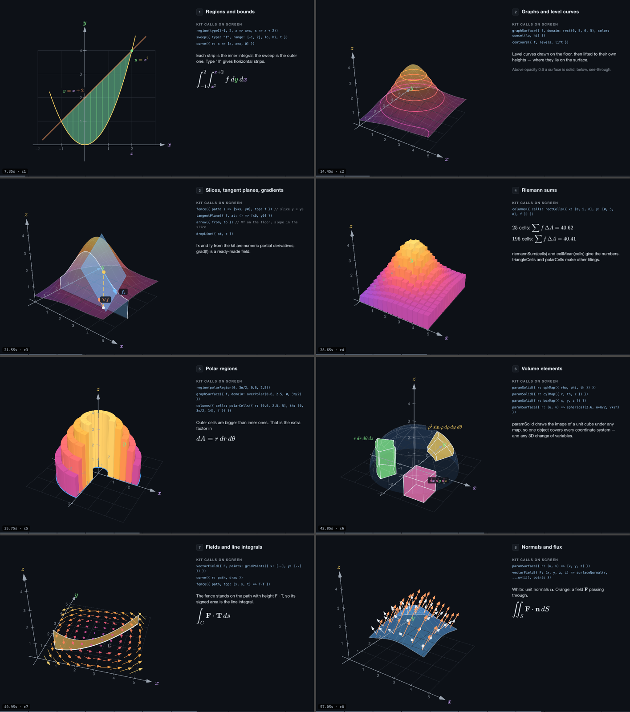

# Explainer studio

Narrated 3D explainer videos for calculus, built to be driven by a coding agent. You give it a narration script and a scene file; it speaks the script with a local neural voice, syncs every highlight and camera move to the spoken word, and renders a 1080p60 MP4.



## Quick start

```
npm install
python3 -m venv .venv && .venv/bin/pip install -r requirements.txt

./studio narrate kit-gallery            # silent cues: needs no speech model
./studio sheet kit-gallery --cues       # contact sheets in out/review/kit-gallery/
./studio video kit-gallery              # out/kit-gallery.mp4

./studio narrate average-value-triangle # first run downloads the Kokoro voice (~330 MB)
./studio video average-value-triangle   # the full 7.5-minute example
./studio preview average-value-triangle # scrub through it live in a browser
```

Requires Node 20+, Python 3.10–3.12, ffmpeg and Google Chrome. Developed on Apple silicon macOS.

## Making a video

```
./studio new my-topic
```

Then edit `videos/my-topic/narration.json` and `videos/my-topic/video.js`. If you are an agent, start with [CLAUDE.md](CLAUDE.md); the method is in [docs/GUIDE.md](docs/GUIDE.md), the reference in [docs/API.md](docs/API.md), and the mistakes not to repeat in [docs/PITFALLS.md](docs/PITFALLS.md).

## What is in the kit

Axes with cross-fading tick sets; regions between curves and polar sectors; strips that sweep out the bounds of an iterated integral; graphs over any domain, with walls and level curves; parametric surfaces; tangent planes; slices and fences for partial derivatives and line integrals; vector fields and normals; Riemann columns on rectangular, triangular and polar tilings; volume elements in Cartesian, cylindrical and spherical coordinates; grids that morph under a change of variables.

`videos/kit-gallery/video.js` shows each one in a dozen lines.

## How it works

The page in `core/` draws any moment of a video as a pure function of time: Three.js for the 3D picture, KaTeX for equations. `tools/synth.py` turns the script into speech with Kokoro, which also reports when each word is spoken. Scenes refer to those words (`'4d@swing'`), so the visuals stay in sync when the script changes. `tools/studio.mjs` drives headless Chrome one frame at a time and pipes the frames to ffmpeg.
